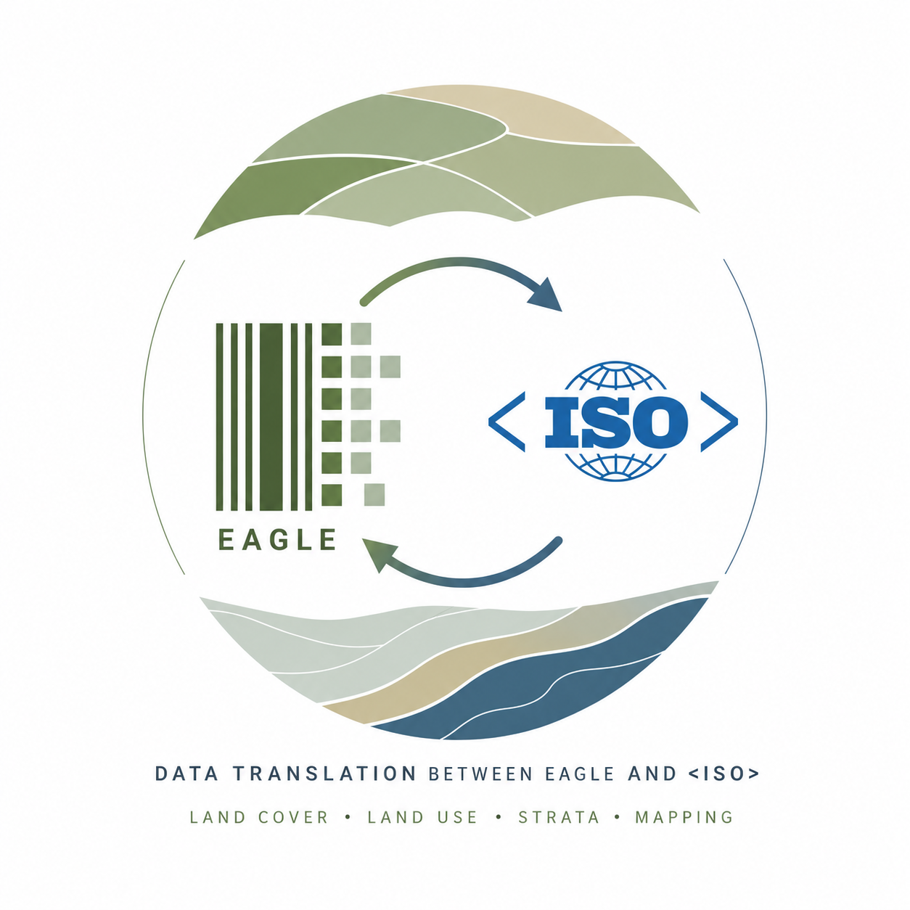

# 🦅 EAGLE ↔️ ISO 19144-2 Mapping Application

<p align="center">
  
</p>

## 1. General Information & Context

### Motivation
Land monitoring governance requires high semantic interoperability between national and international reporting standards. Translating land cover classification systems often suffer from manual interpretation errors, inconsistent nomenclature bookkeeping, and a lack of software-supported translation validation.

### Context & Problem Statement
This project bridges the gap between two primary spatial frameworks:
* **The EAGLE Concept (EIONET):** A data model using a barcoding matrix approach to decompose land cover classes into explicit, measurable segments and land characteristics.
* **ISO 19144-2 (LCML - Land Cover Meta Language):** A structured, relational, international standard for defining land cover logic, frequently exported from official tools (e.g., the FAO LChS Tool).

The core challenge lies in the translation rules. For instance, converting an EAGLE factor code into an ISO coverage percentage range (e.g., EAGLE factor `055` maps semantically to an ISO threshold of `30% - 80%`) is prone to errors when processed manually. Furthermore, administrative variations inside official LChS XML outputs (such as mixed singular/plural tags like `LC_Tree` vs. `LC_Trees` or trailing spaces in IDs) regularly break traditional data integration engines.

---

## 2. The Solution Architecture

This application provides a highly resilient, automated, bi-directional translation engine between EAGLE Excel matrices and ISO 19144-2 XML models. 

### Key Technical Pillars
* **LinkML as the Single Source of Truth:** Data models are conceptually defined in a [centralized semantic schema](src/model/eagle-iso-mapping.linkml.yaml). Pydantic data classes are automatically generated on application startup, guaranteeing compile-time type safety across the transformation pipeline.
* **Dynamic Robustness:** The translation engine is built defensively. It uses a flexible [lookup dictionary](src/mapping/eagle_iso_sssom.yaml) and fuzzy matching routines to handle inconsistent input data transparently without dropping valid objects.

> 📘 **Detailed Workflow Documentation:** > For extensive technical specifications, execution pipelines, and generated AsciiDoc/PlantUML architecture diagrams, please refer to the [workflow documentation](docs/Readme.adoc)

---

## 3. Web Application User Guide (Streamlit UI)

The web frontend is built using Streamlit and organized into three main functional tabs to isolate processing contexts.

### Tab 1: 📊 EAGLE ➔ ISO (Excel to XML)
* **Purpose:** Convert an EAGLE barcoding matrix (Excel) into a fully populated, hierarchical LChS ISO XML document.
* **How to use:**
  1. Upload your formatted EAGLE `.xlsx` workbook.
  2. The application will perform immediate structured checking to verify that the sheet layout matches the expected matrix headers.
  3. Once validation passes, the **Map to ISO** button becomes active.
  4. Click the button to execute the reverse-mapping algorithm. Real-time extraction logs will appear below.

### Tab 2: 📄 ISO ➔ EAGLE (XML to Excel)
* **Purpose:** Transform an official LChS Export XML (including deep relational multi-table structures) back into an EAGLE matrix barcoding sheet.
* **UI Controls & Tweaks:**
  * **Enable Fuzzy Mapping (Checkbox):** Allows the engine to automatically resolve variations like `LC_Tree` to `Trees`. It is highly recommended to keep this enabled for production files.
  * **Force Hierarchical Parser (Checkbox):** Explicitly switches the processing mode from official relational layout detection to flat hierarchical parsing.
* **How to use:**
  1. Upload the target LChS `.xml` file.
  2. Click **Map to EAGLE** (enabled only after verifying XML well-formedness).
  3. The runtime engine resolves abstract table IDs, normalizes messy data entries (e.g., automatically cleansing typos like `"CLC 322"` with spaces into strict `"CLC322"` keys), and routes the variables to their corresponding matrix columns.

### Tab 3: ⚙️ Admin (Configuration Viewer & Editor)
* **Purpose:** Manage the schema foundation and vocabulary runtime aliases without altering underlying Python files.
* **Functional Sections:**
  1. **Mapping Aliases Editor (`mappings.yaml`):** Provides an interactive text area to live-edit runtime lookup records. If downstream LChS software introduces unexpected vocabulary variations (e.g., custom naming wildcards like `LC_MicroAlgae`), developers or administrators can explicitly cluster them under standard EAGLE categories (like `Algae`) using a clean list syntax. Clicking **Save Mapping Aliases** instantly applies changes to active parser memory.
  2. **LinkML Model Viewer (`eagle-lcml-mapping.linkml.yaml`):** Displays a read-only instance of the active system core configuration. This guarantees structural alignment by allowing data scientists to quickly double-check explicit constraints, allowed Enums, and automatic derivation rules defined at the system level.

### Shared Workspace: Logs & Export
* **Workflow Log:** Positioned at the bottom center of the interface. This dynamically scrolling viewport prints detailed information regarding processing benchmarks, extracted class codes, and structural warnings.
* **Export Section:** Located on the right-hand panel. Upon a successful mapping run, a primary **Download Mapped File** button becomes available, allowing you to save the generated format immediately.

---

## 4. Test Infrastructure

To run verification pipelines or test your local environment configuration, a set of sample data packages representing real-world conversion challenges is provided in the repository.

You can find reference matrix templates, multi-class benchmarks, and official XML outputs here:
```text
testdata/
├── EAGLE Barcoding Examples CLC - v4.xlsx  # Official multi-class horizontal and vertical templates
├── LChS_Legend.lchs.xml                     # Complex relational sample dataset from the LChS Tool
└── README.md                                # Mapping context explanations for the test files

```

---

## 5. Local Development Setup

The repository relies on a unified **Configuration Class** powered by `pydantic-settings` to handle operational environments. Paths can be modified dynamically via a `.env` configuration file.

To run this project locally, ensure you have `uv` installed, then invoke the centralized python bootstrapper:

```bash
# Clone the repository, then change into the project folder
cd eagle-iso-mapper  # from the repository root

# Execute via uv (automatically builds LinkML Pydantic models & boots up Streamlit)
uv run run.py
```
