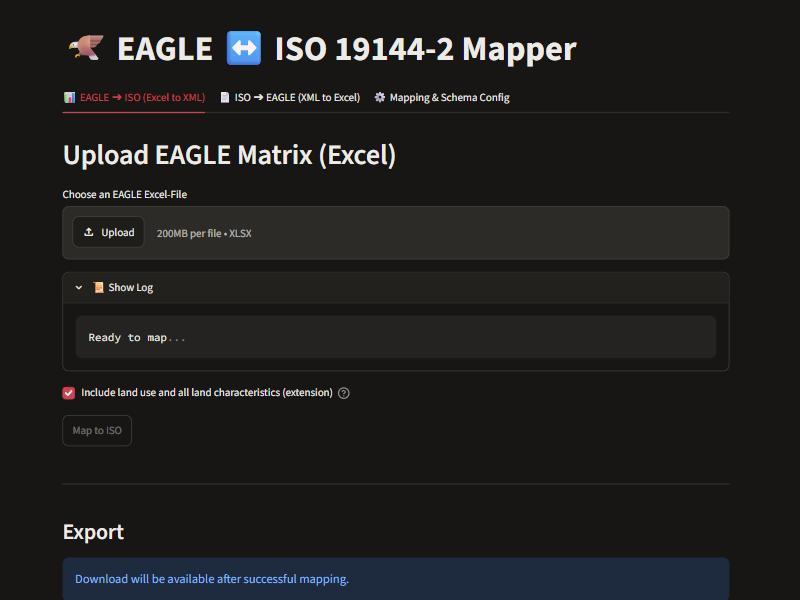
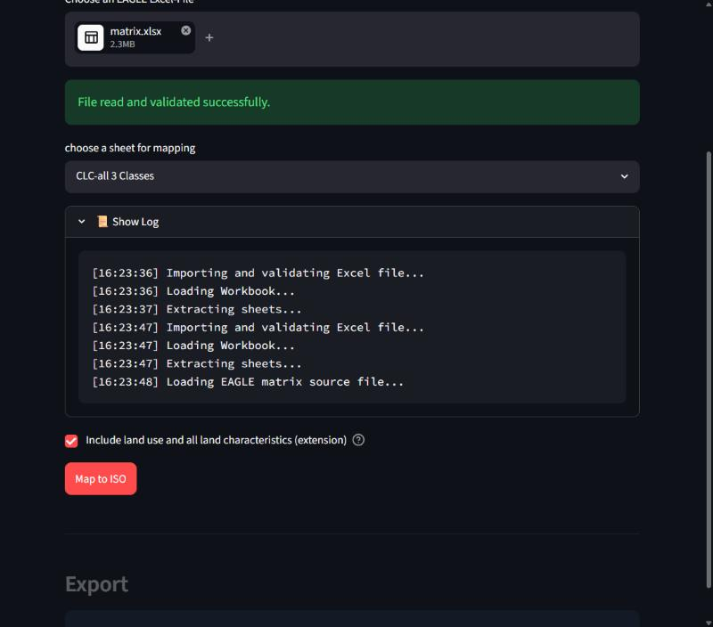
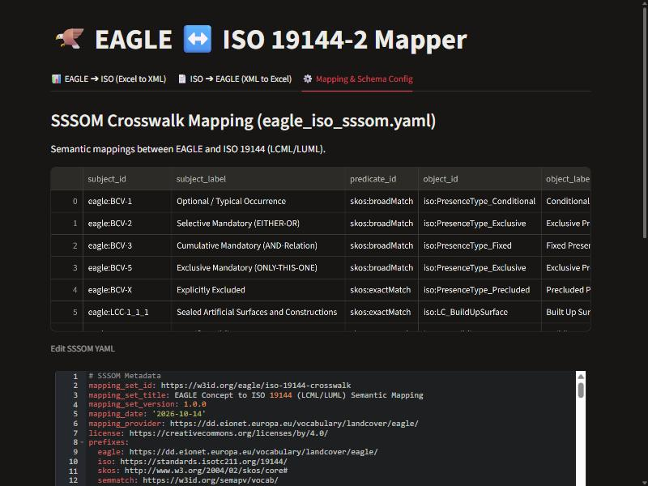

# Mapping EAGLE ↔ ISO 19144: what is written, what is read

This page describes how the mapper turns an EAGLE barcoding matrix into LChS XML (ISO 19144-2 / LCML) and back. The crosswalk itself lives in `src/mapping/eagle_iso_sssom.yaml`; the extension vocabulary (land use, characteristics, irrigation code lists) in `src/mapping/eagle_iso_extensions.yaml`. For the standards background see [standards-usage.md](standards-usage.md).

Contents: [1. EAGLE ➔ ISO](#1-eagle--iso) · [2. Cover](#2-cover-ranges-and-the-100-rule) · [3. Extension](#3-land-use-characteristics-and-irrigation-extension) · [4. ISO ➔ EAGLE](#4-iso--eagle) · [5. Not verified](#5-not-verified--open-points)

## 1. EAGLE ➔ ISO

Each class column of the matrix becomes one `LC_Class` with one horizontal pattern and one stratum. The rows are sorted by their EAGLE **code prefix**, not by their label:

| EAGLE block | Written as | Always written? |
|---|---|---|
| `LCC-…` land cover components | `LC_Properties` (block reference from the SSSOM crosswalk, presence type, `cover`) | yes |
| `LCH-…` irrigation, rice, hops | `LC_Characteristics` (FAO profile: `irrigationType`, `speciesName`) | yes |
| `LUA-…` land use attributes | `LU_LandUse` | extension only |
| all other `LCH-…` | `LC_Characteristics` with a characteristic class and `CharacteristicCode` | extension only |

Bar code values become presence types (`BCV 3` Fixed, `1` Conditional, `2`/`5` Exclusive, `X` **Precluded**). `X` is kept for land use and characteristics as well as for land cover.

The generated class text says **Corine**: `class_description` is `Corine class <code>` (and EAGLE Eye's default class name is `Corine class`). The legend metadata still names the tool (`legend_author`: EAGLE ISO Mapper) as provenance.

Matching by code matters: earlier versions matched labels by substring, so *No Irrigation* was written as irrigation, a label containing *hops* (workshops) as hops, and a land use whose label said "land cover" as a land cover component. The code prefix now decides; the label is only a fallback for rows without a code.

## 2. Cover ranges and the 100% rule

**There are no `minCoverage` / `maxCoverage` elements.** ISO 19144-2 models the cover as one range; the LChS XML serialises it as two repeated `<cover>` elements, first the minimum, then the maximum percentage. The FAO reference file (`testdata/iso`) shows it: a class of "30–80% sealed" has `<cover>30</cover><cover>80</cover>`. This is taken from that file, not from the text of the standard. `LC_HorizontalPatterns` does the same for `cover` and `occurrence`.

EAGLE factors are turned into ranges (`055` → 30–80, `075` and `0.875` → 75–100, other values ±15 around the value).

**The covers of a stratum add up to 100%, never more.** All elements of a class share one stratum, so before writing, `src/mapping/cover.py` makes the ranges fit. A stratum can only be filled if

```
sum of the minima  ≤  100  ≤  sum of the maxima
```

* every range is clamped to 0–100 (minimum ≤ maximum);
* a **precluded** element covers nothing: `0–0` (before it was written as 0–100);
* an element with a **more specific element in the same stratum** is the sum of those (Vegetation next to Graminoids), so only the most specific ones are added up;
* **exclusive** elements (either-or) are alternatives: one of them occurs, so the largest minimum counts once;
* minima that add up to more than 100% are **scaled down in proportion**, and the log says so (`⚠️ <class>: the minimum covers add up to 150%: scaled down to fit 100%`);
* maxima that cannot reach 100% are **reported, not invented**: the rest of the stratum is simply not described.

Conditional and optional elements count with their minimum too, which is the conservative reading ("never more than 100%" for any combination). This rule is our interpretation of the expert's note and should be confirmed.

## 3. Land use, characteristics and irrigation (extension)

The FAO LChS profile carries land cover, and irrigation, rice and hops only as characteristics of vegetation. Land use belongs to ISO 19144-3 (LUML), a separate schema, and **no ISO code lists exist** for irrigation types, irrigation water sources or irrigation regimes. The mapper therefore writes the following **as a project extension in the style of ISO 19144, not as a published schema**. UML: [diagrams/irrigation-extension.puml](diagrams/irrigation-extension.puml).

* **`LU_LandUse`** per land use attribute: `class_id`, `LandUseCode`, `hilucsCode` (from the code, `LUA-5_1` → `5.1`), `LandUseLabel`, `LandUseURI`, `elementPresenceType`, `functionalRelationship`, `temporalRelationship`.
* **`LC_Characteristics`** per land characteristic, with `CharacteristicReference` chosen by code prefix (longest prefix wins, on code segment boundaries):

  | Prefix | Class |
  |---|---|
  | `LCH-5_1_4_5`, `LCH-5_1_4_6` | `LC_IrrigationCharacteristic` |
  | `LCH-4_2` | `LC_WaterRegimeCharacteristic` |
  | `LCH-5_1_4` | `LC_CultivationCharacteristic` |
  | `LCH-5` | `LC_ManagementCharacteristic` |
  | everything else | `LC_GeneralCharacteristic` |

  Rice and hops stay `LC_FloristicAspectsCharacteristic` with `speciesName`. The characteristic is attached to the class's first biotic element (`BlockReference`).
* **`LC_IrrigationCharacteristic`**: all irrigation concepts of a class are merged into one element **per presence type** (the either-or methods and a mandatory water source differ in presence), with `irrigated`, `irrigationType`, `waterSource` and one `CharacteristicCode` per source concept.

### Irrigation code lists

| EAGLE code | EAGLE concept | Written as |
|---|---|---|
| `LCH-5_1_4_5_1` | No Irrigation | `irrigated = false` |
| `LCH-5_1_4_5_2` | Irrigation applied, method unspecified | `irrigated = true`, `unspecified` |
| `LCH-5_1_4_5_3` | Gravity surface irrigation | `gravitySurface` (broader than `flood`, `basin`, `furrow`, `borderStrip`) |
| `LCH-5_1_4_5_4` | Sprinkler irrigation | `sprinkler` |
| `LCH-5_1_4_5_5` | Irrigation carousel | `centerPivot` |
| `LCH-5_1_4_5_6` | Drip irrigation | `drip` (its micro-sprayers are narrower: `microSprinkler`) |
| `LCH-5_1_4_5_7` | Subsurface drip irrigation | `subsurfaceDrip` |
| `LCH-5_1_4_5_8` | Manual irrigation | `manual` |
| `LCH-5_1_4_6_1` | Groundwater | `waterSource = groundwater` |
| `LCH-5_1_4_6_2` | Reservoir | `waterSource = reservoir` |
| `LCH-5_1_4_6_3` | Water course | `waterSource = surfaceWater` (narrower) |

`IrrigationType` = flood, basin, furrow, borderStrip, sprinkler, centerPivot, linearMove, drip, microSprinkler, subsurfaceDrip, other, plus **gravitySurface, manual, unspecified** (added to carry EAGLE without loss). `WaterSource` = surfaceWater, groundwater, reservoir, recycledWater, desalinatedWater, mixed, unknown. `IrrigationRegime` (permanent, seasonal, supplemental, intermittent, emergency) has no EAGLE concept yet and stays unused.

Excluded irrigation (`X`) is written with presence `Precluded`: excluding irrigation in general (`LCH-5_1_4_5_2`) means `irrigated = false` without a type; excluding a method or a source keeps that value.

### Plain LChS subset

`include_extensions=False` (the checkbox *Include land use and all land characteristics* in the web app) writes only land cover plus irrigation, rice and hops in the FAO form (`LC_CultivatedAndManagedVegetationCharacteristics` with `irrigationType`, capitalised as in the FAO export). Precluded characteristics are skipped, since the plain profile cannot say "no sprinkler irrigation".

## 4. ISO ➔ EAGLE

The reverse direction reads what the forward direction writes, so the round trip keeps land use and characteristics:

* **`LU_LandUse`** (by `class_id`) → land use rows of the matrix, with code, HILUCS code and presence.
* **`LC_Characteristics` with `CharacteristicCode`** → one matrix row per code, with the presence type as bar code value (`Precluded` → `X`, `Fixed` → 3, `Conditional` → 1, `Exclusive` → 2). Exclusive comes back as `2` also where the source had `5`.
* **Irrigation without codes** (written by another tool: only `irrigated`, `irrigationType`, `waterSource`) is read through the code lists, ignoring case, so the FAO value `Sprinkler` finds `LCH-5_1_4_5_4`. Values with no EAGLE concept map to the nearest one: `flood`, `basin`, `furrow`, `borderStrip` → gravity surface; `linearMove` → sprinkler; `microSprinkler` → drip; `other` → irrigation, method unspecified. A water source EAGLE does not know (`recycledWater`, `desalinatedWater`, `mixed`, `unknown`) is dropped.
* **Plain FAO files**, which do not state a presence for characteristics: irrigation comes back as `2` and rice / hops as `X`, as before.
* **Species** (`speciesName`) are matched to their EAGLE code (`Oryza sativa` → rice, `Humulus lupulus` → hops).
* Matrix rows for land use and characteristics are added to their section (LCC, LUA, LCH) with the level taken from the code (`LCH-5_1_4_5_4` → 5). A precluded cover range (`0–0`) does not come back as a factor.

Not read back: `functionalRelationship` / `temporalRelationship` (the matrix has no column for them) and the hierarchical (`LegendClass`) XML flavour, which has no extension elements.

## 5. Not verified / open points

* Whether the **FAO LChS tool imports** the extension elements is untested. That is what the plain-subset switch is for.
* The stratum rule in [section 2](#2-cover-ranges-and-the-100-rule) is an interpretation to confirm with the EAGLE expert, in particular counting conditional minima and treating exclusive elements as alternatives.
* `LU_LandUse` and the characteristic classes are named in the style of ISO 19144 (`LC_…`, `LU_…`) but are not defined by any published schema; agree names and structure before exchanging the files.
* The irrigation list is a proposal: `gravitySurface`, `manual` and `unspecified` were added, and `LC_GeneralCharacteristic` was added as a fifth characteristic class because most EAGLE characteristics (built-up, physical, spatial, status) fit none of the four proposed ones.

## 6. Web app

`streamlit run app.py` (or `python run.py`) opens three tabs: *EAGLE ➔ ISO*, *ISO ➔ EAGLE* and *Mapping & Schema Config*.

**EAGLE ➔ ISO.** Upload the matrix, pick the sheet and press *Map to ISO*. The checkbox *Include land use and all land characteristics (extension)* switches between the extended and the plain LChS output ([section 3](#plain-lchs-subset)).



The log shows each step live, including the cover warnings of [section 2](#2-cover-ranges-and-the-100-rule) (screenshot taken while a 2.3 MB matrix was being mapped):



**ISO ➔ EAGLE** takes an LChS XML file, plain or with the extension elements ([section 4](#4-iso--eagle)).

**Mapping & Schema Config.** The SSSOM crosswalk is edited in a YAML editor with syntax highlighting, line numbers and code folding (`streamlit-ace`). The editor sits in a form: typing does not rerun the page, and the text is checked as YAML and saved with *Save SSSOM Crosswalk*, which also reloads the crosswalk. Invalid YAML is rejected with the parser's message and the file stays untouched.


