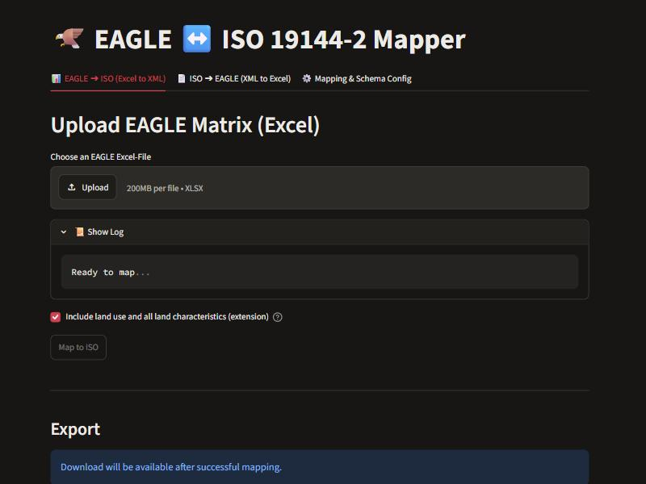
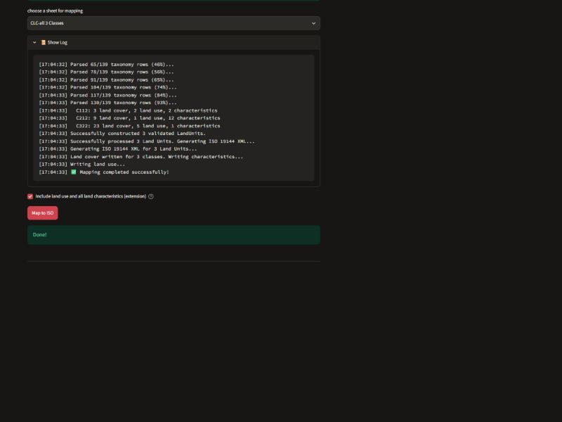
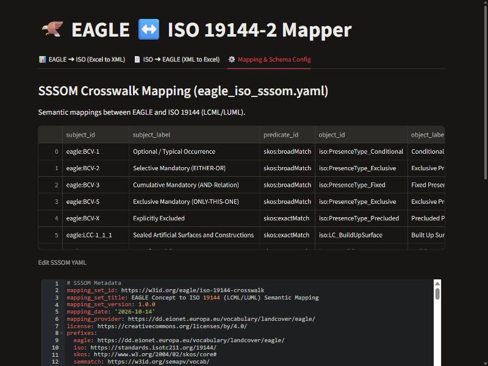

# Mapping EAGLE ↔ ISO 19144: what is written, what is read

This page describes how the mapper turns an EAGLE barcoding matrix into LChS XML (ISO 19144-2 / LCML) and back. The crosswalk itself lives in `src/mapping/eagle_iso_sssom.yaml`; the extension vocabulary (land use, characteristics, irrigation code lists) in `src/mapping/eagle_iso_extensions.yaml`. For the standards background see [standards-usage.md](standards-usage.md).

Contents: [1. EAGLE ➔ ISO](#1-eagle--iso) · [2. Cover](#2-cover-ranges-and-the-100-rule) · [3. Extension](#3-land-use-characteristics-and-irrigation-extension) · [4. ISO ➔ EAGLE](#4-iso--eagle) · [5. Not verified](#5-not-verified--open-points)

## 1. EAGLE ➔ ISO

Each class column of the matrix becomes one `LC_Class` with one horizontal pattern and one stratum. The rows are sorted by their EAGLE **code prefix**, not by their label:

| EAGLE block | Written as | Always written? |
|---|---|---|
| `LCC-…` land cover components | `LC_Properties` (block reference from the SSSOM crosswalk, presence type, `cover`) | yes |
| `LCH-…` irrigation, rice, hops | `LC_Characteristics` (FAO profile: `irrigationType`, `speciesName`) | yes |
| `LUA-…` land use attributes | `LU_LandUse` | extension only |
| all other `LCH-…` | `LC_Characteristics` with a characteristic class and `CharacteristicCode` | extension only |

Bar code values become the **element presence types of the FAO LChS tool**, which are only `Fixed`, `Exclusive`, `Conditional Temporal` and `Precluded` (there is no plain "Conditional"; the tool's own export writes *Conditional Temporal* for optional elements):

| BCV (manual D3-1a, table 3) | Meaning | Presence type |
|---|---|---|
| `3` | cumulative mandatory (AND): all must be present | Fixed |
| `1` | optional, can occur as typical | **Conditional Temporal** |
| `2` | selective mandatory (EITHER-OR): at least one of the group | Exclusive |
| `4` | paired mandatory: at least two of the group | Exclusive (the minimum of two is not expressible) |
| `5` | exclusive mandatory (NOTHING-BUT): the only element of its block | Exclusive |
| `X` | excluded by definition | **Precluded** |

`X` is kept for land use and characteristics as well as for land cover. Files that still say `Conditional` or `Optional` are read as BCV 1.

ISO presence types cannot tell every bar code value apart: **BCV 2, 4 and 5 are all Exclusive**. The log says so per class. With the extensions every element also carries `EagleBcv`, the bar code value itself, so ISO ➔ EAGLE returns 2, 4 and 5 exactly; the plain LChS subset cannot (all three return as 2).

The generated class text says **Corine**: `class_description` is `Corine class <code>` (and EAGLE Eye's default class name is `Corine class`). The legend metadata still names the tool (`legend_author`: EAGLE ISO Mapper) as provenance.

Matching by code matters: earlier versions matched labels by substring, so *No Irrigation* was written as irrigation, a label containing *hops* (workshops) as hops, and a land use whose label said "land cover" as a land cover component. The code prefix now decides; the label is only a fallback for rows without a code.

### Land cover blocks: what the crosswalk covers

Every one of the 55 EAGLE land cover concepts has a block of the FAO LChS tool: the crosswalk has a row for 39 of them, the others take the row of their **nearest ancestor** (Boulders `LCC-1_2_2_1_1` → Mineral Fragments `LCC-1_2_2_1` → `LC_CoarseMineralFragments`). The block names, their hierarchy and the presence and irrigation types come from the tool itself (`src/mapping/fao_lchs_profile.json`, extracted from the tool's `DataSources` by `scripts/extract_fao_profile.py`), and the tests check every row against it. `exactMatch` rows are a block of the same meaning, `closeMatch` nearly the same (Consolidated Surfaces → Rocks Surface), `broadMatch` a broader block (Sand, Grit → Soils & Sand Deposits Surface). Labels are not used for matching.

* In the **plain LChS subset**, concepts that share one block are merged into one property (stated presence wins, the cover range spans them); the log says so.
* With the **extensions**, each property also carries `EagleCode` and `EagleLabel`, so ISO ➔ EAGLE returns the exact concept and not just its block.
* A code outside the EAGLE vocabulary has no block: it is written under a name derived from its label and the log warns (`no ISO block is known for …`). Characteristics (irrigation, species) are attached to a vegetation block, the only blocks the FAO tool allows them on.
* Fixed on 2026-11-16: the row `LCC-2_4_2` was labelled *Algae* (it is *Mosses*; Algae is `LCC-2_4_3`), the names `LC_BuildUpSurface`, `LC_Soil`, `LC_Vegetation` were corrected to `LC_BuiltUpSurface`, `LC_BareSoil`, `LC_VegetationElement` (older files with the old names are still read), and the presence type of optional elements is `Conditional Temporal`, not `Conditional`.
* The crosswalk IDs (`eagle:LCC-1_1_1`) identify concepts **by code**. The Eionet URIs of the vocabulary are slug based and travel in the matrix (column A); the crosswalk prefix is `https://w3id.org/eagle/code/` and does not pretend to be an Eionet URI. A test checks every row against the shared vocabulary JSON (`eagle_vocabulary.json`, set `EAGLE_VOCABULARY` if it is not next to the mapper).

## 2. Cover ranges and the 100% rule

**There are no `minCoverage` / `maxCoverage` elements.** ISO 19144-2 models the cover as one range; the LChS XML serialises it as two repeated `<cover>` elements, first the minimum, then the maximum percentage. The FAO reference file (`testdata/iso`) shows it: a class of "30–80% sealed" has `<cover>30</cover><cover>80</cover>`. This is taken from that file, not from the text of the standard. `LC_HorizontalPatterns` does the same for `cover` and `occurrence`.

EAGLE factors are the middle of their cover interval: `0.55` is 30–80%, `0.875` is 75–100% (`0.75` is read as 75–100% too). Only these intervals are known. **Any other factor (the template workbook also uses 0.5 and 0.375) cannot be turned back into an interval, so the cover stays open (0–100%) and the log reports it**; the mapper used to invent ±15 around the value. A factor of `1` (the default of the CLC barcoding library) states no cover; it used to become 0–16%. In the other direction the factor is written as a number, the middle of the interval (30–80% → 0.55, 75–100% → 0.875, 25–50% → 0.375).

**The covers of a stratum add up to 100%, never more.** All elements of a class share one stratum, so before writing, `src/mapping/cover.py` makes the ranges fit. A stratum can only be filled if

```
sum of the minima  ≤  100  ≤  sum of the maxima
```

* every range is clamped to 0–100 (minimum ≤ maximum);
* a **precluded** element covers nothing: `0–0` (before it was written as 0–100);
* an element with a **more specific element in the same stratum** is the sum of those (Vegetation next to Graminoids), so only the most specific ones are added up;
* **exclusive** elements (either-or) are alternatives: one of them occurs, so the largest minimum counts once;
* minima that add up to more than 100% are **scaled down in proportion**, and the log says so (`⚠️ <class>: the minimum covers add up to 150%: scaled down to fit 100%`);
* maxima that cannot reach 100% are **reported, not invented**: the rest of the stratum is simply not described.

Conditional and optional elements count with their minimum too, which is the conservative reading ("never more than 100%" for any combination). This rule is our interpretation of the expert's note and should be confirmed.

## 3. Land use, characteristics and irrigation (extension)

The FAO LChS profile carries land cover, and irrigation, rice and hops only as characteristics of vegetation. Land use belongs to ISO 19144-3 (LUML), a separate schema, and **no ISO code lists exist** for irrigation types, irrigation water sources or irrigation regimes. The mapper therefore writes the following **as a project extension in the style of ISO 19144, not as a published schema**. UML: [diagrams/irrigation-extension.puml](diagrams/irrigation-extension.puml).

* **`LU_LandUse`** per land use attribute: `class_id`, `LandUseCode`, `hilucsCode` (from the code, `LUA-5_1` → `5.1`), `LandUseLabel`, `LandUseURI`, `elementPresenceType`, `functionalRelationship`, `temporalRelationship`.
* **`LC_Characteristics`** per land characteristic, with `CharacteristicReference` chosen by code prefix (longest prefix wins, on code segment boundaries):

  | Prefix | Class |
  |---|---|
  | `LCH-5_1_4_5`, `LCH-5_1_4_6` | `LC_IrrigationCharacteristic` |
  | `LCH-4_2` | `LC_WaterRegimeCharacteristic` |
  | `LCH-5_1_4` | `LC_CultivationCharacteristic` |
  | `LCH-5` | `LC_ManagementCharacteristic` |
  | everything else | `LC_GeneralCharacteristic` |

  Rice and hops stay `LC_FloristicAspectsCharacteristic` with `speciesName`. The characteristic is attached to the class's first biotic element (`BlockReference`).
* **`LC_IrrigationCharacteristic`**: all irrigation concepts of a class are merged into one element **per presence type** (the either-or methods and a mandatory water source differ in presence), with `irrigated`, `irrigationType`, `waterSource` and one `CharacteristicCode` per source concept.

### Irrigation code lists

| EAGLE code | EAGLE concept | Written as |
|---|---|---|
| `LCH-5_1_4_5_1` | No Irrigation | `irrigated = false` |
| `LCH-5_1_4_5_2` | Irrigation applied, method unspecified | `irrigated = true`, `unspecified` |
| `LCH-5_1_4_5_3` | Gravity surface irrigation | `gravitySurface` (broader than `flood`, `basin`, `furrow`, `borderStrip`) |
| `LCH-5_1_4_5_4` | Sprinkler irrigation | `sprinkler` |
| `LCH-5_1_4_5_5` | Irrigation carousel | `centerPivot` |
| `LCH-5_1_4_5_6` | Drip irrigation | `drip` (its micro-sprayers are narrower: `microSprinkler`) |
| `LCH-5_1_4_5_7` | Subsurface drip irrigation | `subsurfaceDrip` |
| `LCH-5_1_4_5_8` | Manual irrigation | `manual` |
| `LCH-5_1_4_6_1` | Groundwater | `waterSource = groundwater` |
| `LCH-5_1_4_6_2` | Reservoir | `waterSource = reservoir` |
| `LCH-5_1_4_6_3` | Water course | `waterSource = surfaceWater` (narrower) |

`IrrigationType` = flood, basin, furrow, borderStrip, sprinkler, centerPivot, linearMove, drip, microSprinkler, subsurfaceDrip, other, plus **gravitySurface, manual, unspecified** (added to carry EAGLE without loss). `WaterSource` = surfaceWater, groundwater, reservoir, recycledWater, desalinatedWater, mixed, unknown. `IrrigationRegime` (permanent, seasonal, supplemental, intermittent, emergency) has no EAGLE concept yet and stays unused.

Excluded irrigation (`X`) is written with presence `Precluded`: excluding irrigation in general (`LCH-5_1_4_5_2`) means `irrigated = false` without a type; excluding a method or a source keeps that value.

### Plain LChS subset

`include_extensions=False` (the checkbox *Include land use and all land characteristics* in the web app) writes only land cover plus irrigation, rice and hops in the FAO form (`LC_CultivatedAndManagedVegetationCharacteristics` with `irrigationType`). The FAO tool knows three irrigation types, **Surface, Sprinkler and Drip**: gravity surface irrigation is written as Surface, sprinkler and carousel as Sprinkler, drip and subsurface drip as Drip, once each; manual or unspecified irrigation has no FAO type and is written without one. Precluded characteristics are skipped, since the plain profile cannot say "no sprinkler irrigation".

## 4. ISO ➔ EAGLE

The reverse direction reads what the forward direction writes, so the round trip keeps land use and characteristics:

* **`LU_LandUse`** (by `class_id`) → land use rows of the matrix, with code, HILUCS code and presence.
* **`LC_Characteristics` with `CharacteristicCode`** → one matrix row per code, with the presence type as bar code value (`Precluded` → `X`, `Fixed` → 3, `Conditional Temporal` → 1, `Exclusive` → 2). With `EagleBcv` (extension output) the exact value comes back, including 4 and 5; plain LChS files, which have no such element, return Exclusive as `2` and Conditional as `1`.
* **Irrigation without codes** (written by another tool: only `irrigated`, `irrigationType`, `waterSource`) is read through the code lists, ignoring case, so the FAO value `Sprinkler` finds `LCH-5_1_4_5_4`. Values with no EAGLE concept map to the nearest one: `flood`, `basin`, `furrow`, `borderStrip` → gravity surface; `linearMove` → sprinkler; `microSprinkler` → drip; `other` → irrigation, method unspecified. A water source EAGLE does not know (`recycledWater`, `desalinatedWater`, `mixed`, `unknown`) is dropped.
* **Plain FAO files**, which do not state a presence for characteristics: irrigation comes back as `2` and rice / hops as `X`, as before.
* **Species** (`speciesName`) are matched to their EAGLE code (`Oryza sativa` → rice, `Humulus lupulus` → hops).
* An ISO block no crosswalk row knows becomes **a matrix row of its own** (`LCC-Custom-<BlockName>`); they used to share one row, so only the first survived.
* **The matrix rows**: the three segment headings (LCC, LUA, LCH) and one row per concept the classes use. Every row has its **Eionet URI, official label and level** from the EAGLE vocabulary (`src/mapping/eagle_concepts.json`, a bundled extract of the shared vocabulary JSON; `EAGLE_VOCABULARY` points to the full file instead, `scripts/extract_eagle_concepts.py` refreshes the extract). Rows are in **matrix order**: section, then the numeric segments of the code, so a parent stands right before its children (`LCC-2_2`, `LCC-2_2_1`, `LCC-2_2_1_1`, `LCC-2_2_2`) and `LCH-5_1_2` before `LCH-5_1_10`. Sorting by level alone would put every level-1 row before every level-2 row and separate the children from their parent; with one stratum per class the code order is the order of the EAGLE template. A compound class and its parts are separate rows: `LC_LichenAndMoss` is `LCC-2_4` (Lichens, Mosses, Algae), `LC_Moss` is `LCC-2_4_2` and `LC_Algae` is `LCC-2_4_3`, each with its own URI.

Not read back: `functionalRelationship` / `temporalRelationship` (the matrix has no column for them) and the hierarchical (`LegendClass`) XML flavour, which has no extension elements.

## 5. Not verified / open points

* Whether the **FAO LChS tool imports** the extension elements is untested. That is what the plain-subset switch is for.
* The stratum rule in [section 2](#2-cover-ranges-and-the-100-rule) is an interpretation to confirm with the EAGLE expert, in particular counting conditional minima and treating exclusive elements as alternatives.
* `LU_LandUse` and the characteristic classes are named in the style of ISO 19144 (`LC_…`, `LU_…`) but are not defined by any published schema; agree names and structure before exchanging the files.
* **The factor column** is not defined in the bar coding manual (D3-1a) or the thematic guidance (D3-1b); only 0.55 (30-80%) and 0.875 (75-100%) are treated as known intervals. The template workbook also uses 0.5 and 0.375, and the CLC barcoding library has 1.0 everywhere. Ask the EAGLE expert for the factor table; each further factor is one line in `sssom_engine.py`.
* **BCV 1 as *Conditional Temporal*** follows the FAO tool's own reference export (optional trees and shrubs of CLC 322) and is the only non-mandatory presence type the tool offers; it is not a statement that optional elements are temporal. **BCV 4 and 5 as Exclusive** is our reading of manual table 3 (a group of alternatives; the only element of its block). Both are for the EAGLE expert to confirm.
* The `closeMatch` and `broadMatch` rows (for example Open Sealed Surfaces → Non-Built-Up Surface) are our judgement of the FAO block library, not a published crosswalk.
* The irrigation list is a proposal: `gravitySurface`, `manual` and `unspecified` were added, and `LC_GeneralCharacteristic` was added as a fifth characteristic class because most EAGLE characteristics (built-up, physical, spatial, status) fit none of the four proposed ones.

## 6. Web app

`streamlit run app.py` (or `python run.py`) opens three tabs: *EAGLE ➔ ISO*, *ISO ➔ EAGLE* and *Mapping & Schema Config*.

**EAGLE ➔ ISO.** Upload the matrix, pick the sheet and press *Map to ISO*. The checkbox *Include land use and all land characteristics (extension)* switches between the extended and the plain LChS output ([section 3](#plain-lchs-subset)).



The log and a progress bar show each step live: the sheet that is read, the taxonomy rows parsed (in tenths), a summary per class (land cover / land use / characteristics), the cover warnings of [section 2](#2-cover-ranges-and-the-100-rule), and the writing of land cover, characteristics and land use. The screenshot shows a finished run of a 2.3 MB workbook:



**Speed.** Three things used to make the app feel stuck:

* *Excel import.* A full `openpyxl.load_workbook` parses every sheet with all its styles, which took 15 s (about 27 s in the app) for the 2.3 MB EAGLE workbook. The app now lists the sheet names from a read-only open (which only parses the workbook index) and reads only the **selected sheet, values only** (`load_matrix`, about 0.5 s). The other sheets, which may hold a lot of text, are never parsed. The result is identical: the mapping of the loaded sheet equals the mapping of the full workbook (tested), and a whole run takes about 2 s.
* *Start-up.* Importing `pandas` and `sssom` takes 20-30 s. It used to happen before anything was drawn (blank page); now the splash screen with a "loading the mapping engine" spinner shows after a few seconds, and the engine is loaded once per server process.
* *Progress.* Parsing and writing report their progress (`progress_callback(fraction, message)` in `run_eagle_to_iso_mapping`) and the log keeps the last 40 lines instead of 15.

**ISO ➔ EAGLE** takes an LChS XML file, plain or with the extension elements ([section 4](#4-iso--eagle)).

**Mapping & Schema Config.** The SSSOM crosswalk is edited in a YAML editor with syntax highlighting, line numbers and code folding (`streamlit-ace`). The editor sits in a form: typing does not rerun the page, and the text is checked as YAML and saved with *Save SSSOM Crosswalk*, which also reloads the crosswalk. Invalid YAML is rejected with the parser's message and the file stays untouched.


